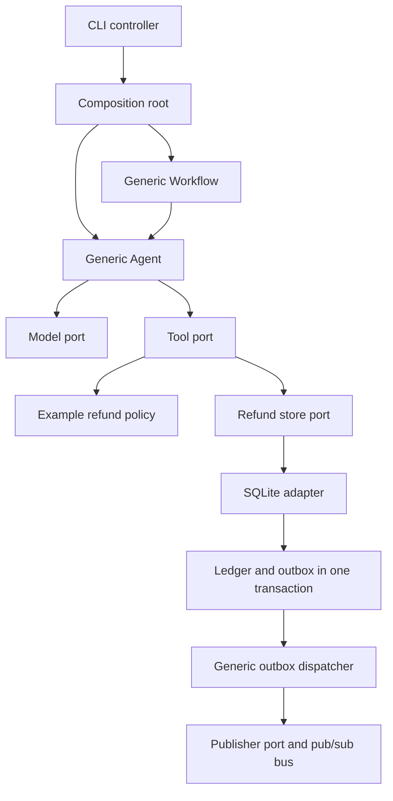

# Agent TDD Lab

[](https://github.com/ZGTR/agent-tdd-lab/actions/workflows/ci.yml)

A framework-independent Python reference for testing agents, harnesses, tools, and multi-agent workflows. Clone it, run it without credentials, and replace the model/tool adapters for your application.

**Status:** production-oriented reference implementation with a tested local SQLite effect simulator. It does not send money, authenticate HTTP callers, guarantee model quality, or provide a distributed agent runtime. Read [production integration requirements](docs/production.md) before enabling external effects.

## Clone and run

Python 3.11–3.13, Git, and a local writable filesystem are required. No AWS account, API key, Docker, or GPU is needed.

```bash
git clone https://github.com/ZGTR/agent-tdd-lab.git
cd agent-tdd-lab
python -m venv .venv
. .venv/bin/activate                 # Windows: .venv\Scripts\activate
python -m pip install --require-hashes -r requirements-dev.txt
python -m pip install --no-deps --no-build-isolation -e .
python -m pytest
agent-tdd workflow
agent-tdd refund --db demo.db --approve
agent-tdd refund --db demo.db --approve  # same receipt; no second effect/event
```

`agent-tdd refund --db blocked.db` exits **2** with `approval_required`. Successful examples exit **0**. Run `agent-tdd --help`. All amounts come from the local order table, never from model-provided arguments.

For reproducible development dependencies, install [uv](https://docs.astral.sh/uv/getting-started/installation/) and use `uv sync --frozen` followed by `uv run --frozen pytest`. `uv.lock` pins the complete dependency graph. The pip path is convenient; the frozen uv path is the reproducible CI path.

If migrating from the original single-file lab, do not keep an `agent_tdd.py` file inside the clone: that filename can shadow the installed `agent_tdd` package.

## Use your own agent

The core does not know about refunds. Models return `Decision` objects; tools implement a protocol; a composition root injects both. A task and output can be any supported JSON value. No base-class inheritance or framework is required.

```python
from agent_tdd.adapters.local import ScriptedModel
from agent_tdd.composition import context
from agent_tdd.harness import Agent
from agent_tdd.types import Decision

model = ScriptedModel([Decision("finish", output={"answer": 42})])
result = Agent(model, {}).run({"question": "example"}, context())
assert result.output == {"answer": 42}
```

For a tool, implement `execute(arguments, context, *, timeout_seconds) -> JsonValue` and register it under a stable name. See [adapter contracts](docs/adapters.md). To use LangGraph, Strands, CrewAI, PydanticAI, Bedrock, or a custom harness, implement the small `Model` or `Step` protocol. Those SDKs are not runtime dependencies of this repository.

## Agents, ordinary steps, and workflows

```python
from agent_tdd.workflow import Node, Workflow

# researcher and reviewer are any Step objects, including Agent or Workflow.
workflow = Workflow([
    Node("research", researcher),
    Node("review", reviewer, depends_on=("research",)),
])
result = workflow.run({"topic": "your task"}, trusted_context)
```

Each node receives `{"task": original_task, "upstream": {dependency: output}}`. Handoffs contain declared dependencies only. The same trusted context and atomic call budget are shared by every child agent. Cycles, duplicate names, missing dependencies, failed upstream steps, cancellation, and deadlines have explicit behavior. Execution is sequential in topological order: this is a small composable runner, not a parallel scheduler or durable workflow engine.

## Architecture and principles



| Principle | Concrete implementation |
| --- | --- |
| SRP | Domain contracts, controller, workflow, authorization, storage, event delivery, and JSON views have separate modules |
| DRY | One authorization policy, one ledger transaction, one generic agent loop; examples use the same core |
| IoC / DI | The composition root constructs adapters and injects protocol implementations; no service locator or global mutable container |
| MVC | Immutable result/decision models; Agent/CLI/workflow controllers; JSON views with no persistence logic |
| Pub/sub | Generic topic bus and durable outbox; subscriber failure cannot roll back an already committed effect |
| OOP / SOLID | Small cohesive objects and structural protocols; composition rather than inheritance-heavy framework coupling |
| Explicit boundaries | Trusted host context stays outside model-generated arguments; provider adapters normalize known errors |

There is deliberately no HTTP server, frontend, broker, plugin loader, or mandatory cloud platform. Add one when the application's requirements justify it.

## Test-first workflow

1. Describe a failure as an invariant, such as “missing approval creates no effect.”
2. Write a failing test through the real controller with a scripted model and isolated tools.
3. Implement the smallest change; run the affected tests.
4. Remove the guard temporarily and prove that the test fails, then restore it.
5. Run the full suite, lint, type checking, coverage, and packaging checks.
6. Add a separate versioned live-model evaluation set. Offline tests establish harness behavior, not model intelligence.

```bash
ruff check .
ruff format --check .
mypy
pytest --cov --cov-report=term-missing --cov-report=xml
python -m build --no-isolation
python scripts/verify_mutation.py
```

Tests cover generic agents, custom tools, arbitrary JSON tasks, DAG handoffs, shared budgets, cancellation, malformed model output, approvals, tenant boundaries, crash/retry behavior, SQLite persistence, concurrent duplicates, and outbox replay. CI uses pinned actions and a Python matrix. No model calls are made by tests.

## Durable effects and events

The refund example uses an atomic SQLite transaction for a unique request key, at-most-one local refund per tenant/order, and an outbox event. Conflicting payloads are rejected. Fresh process/store instances see the same ledger. A lost response after commit can be retried with the original key.

Outbox dispatch is **at least once**. An event may be delivered again after a subscriber succeeds but acknowledgment fails, or when multiple dispatchers race. Consumers must deduplicate by event ID in their own transaction. The in-process bus is configured once at startup and is not a durable message broker. Don't put authorization, payments, or other critical writes in a best-effort observer.

## Documentation

- [Initial verification record](docs/validation.md)
- [Adapter contracts and extending any agent/framework](docs/adapters.md)
- [Production integration and operational limits](docs/production.md)
- [Tutorial: Reliable TDD for Agents](https://mohammadshaker.com/en/blog/reliable-agent-tdd-highest-roi)
- [Contributing](CONTRIBUTING.md), [security reporting](SECURITY.md), [MIT license](LICENSE)
