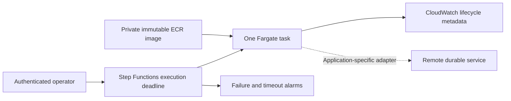

# Deployment and operations

The generic library remains usable without Docker or AWS. The deployment example runs the registered, scripted workflow as an on-demand job. It provisions no HTTP endpoint and no always-running worker. The SQLite refund example is local-only: Fargate's writable layer is ephemeral, and SQLite WAL must not be placed on shared EFS/NFS as a substitute for a remote effect store.

## Local container

```bash
docker build --platform linux/amd64 -t agent-tdd:local .
docker run --rm --read-only --network none --cap-drop ALL \
  --security-opt no-new-privileges:true --pids-limit 64 --memory 512m agent-tdd:local
python scripts/check_container.py agent-tdd:local
```

The image runs as numeric UID/GID 10001, installs a built wheel, and contains no development dependency installation in the runtime stage. Python's base image is pinned by digest. Update that digest through a reviewed patch and rerun the image checks when security updates are published. The default command emits lifecycle metadata to stderr and a metadata-only result to stdout. `--result-mode full` is available for controlled destinations; it can contain application output and tool receipts.

For the local durable simulator:

```bash
docker compose build
docker compose run --rm worker refund --db /data/refunds.db --approve
docker compose run --rm worker refund --db /data/refunds.db --approve
```

The named volume retains the ledger and outbox. The second run emits no second effect event. Compose disables networking, makes the root filesystem read-only, drops capabilities, and sets memory/CPU/process limits. Do not delete the volume until the stored effects and retention requirements have been reviewed.

In a managed environment that requires a custom CA, pass it as a build secret:

```bash
docker build --secret id=proxy_ca,src=/path/to/combined-ca.pem -t agent-tdd:local .
```

The optional secret is mounted only during dependency installation and is not copied into the image. Keep TLS verification enabled. For provider calls at runtime, mount the appropriate trust bundle and inject secrets through your platform's secret mechanism, not through image layers or IaC variables committed to Git.

## Evaluation images

The default image includes the generic runner, public example cases under `/opt/agent-tdd/evals`, and the standard-library OpenAI-compatible adapter. For Bedrock, build the optional hash-locked SDK image:

```bash
docker build --platform linux/amd64 --build-arg WITH_BEDROCK=true -t agent-tdd:bedrock .
python scripts/check_container.py agent-tdd:bedrock
```

Both image variants pass the same offline/replay/evaluation smoke checks. They do not contain provider credentials. Mount a writable private artifact directory/volume and read-only trusted provider configuration when running evaluations; a read-only root without a report volume is rejected by the destination preflight before inference. A later disk or permissions failure can still occur after preflight. Use SDK workload identity or your platform's secrets injection for actual inference, and verify live IAM/network behavior before release. See [evaluation.md](evaluation.md) for cases, reports, gates, and the separate manual CI workflow. The IaC's default task still runs the credential-free workflow, not an evaluation or a refund service.

## AWS architecture



`infra/aws` is an OpenTofu root configuration using the locked AWS provider. It creates ECR, an ECS cluster, task/execution/orchestration roles, a no-ingress security group, CloudWatch logs, and—after an image digest is supplied—a Fargate task definition, Step Functions runner, and failure/timeout alarms. It never starts a task as part of apply.

The execution role can pull only this repository's images and append only this log group's streams. ECR authentication requires the `GetAuthorizationToken` wildcard resource; image retrieval remains repository-scoped. The application task role has no permissions by default. Optional `bedrock_model_arns` grants only `bedrock:InvokeModel` on the explicit selected model/profile ARNs. Include underlying model resources when required by an inference profile. Other application grants remain your own reviewed infrastructure. Optional `github_repository` creates a separate inference-only CI role bound to the repository's `live-evaluation` environment and an existing account GitHub OIDC provider. Restrict that environment to `main` before configuring its role variable; the [setup runbook](evaluation.md#trusted-manual-ci) verifies the branch restriction. The orchestration role can run the fixed task revision, pass the two fixed ECS roles, and monitor/stop this cluster's tasks.

No request-supplied command overrides are accepted by the state machine. Change the trusted `command` IaC variable or ship a new application composition root in your image. There are no automatic effect retries. The managed runner checks container exit code zero; a stopped task alone is not treated as application success.

### Prerequisites

- OpenTofu 1.13.1, Docker, AWS CLI v2, and a selected AWS profile/role with provisioning permissions.
- An existing VPC and private subnets, all in the selected region/VPC.
- A working image/logging network path: ECR API/DKR and CloudWatch Logs interface endpoints plus S3 gateway access, or a NAT path with explicitly configured HTTPS egress. The module does not create a VPC, NAT gateway, endpoints, or routing.
- A private, encrypted, versioned S3 state bucket with restricted operator access. Production state must not live only on a laptop. Native S3 lock files require read/write/delete access to the lock key; state object deletion is not required for normal updates.

These dependencies are explicit so the module can reuse an existing platform. It does not assume that an arbitrary private subnet has internet access. With private endpoints, set `allowed_https_cidrs` to endpoint subnet CIDRs and ensure the endpoint security groups admit TCP 443 from the worker. Regional S3 prefix-list egress is included. With NAT, explicitly allow public HTTPS destinations as needed; `0.0.0.0/0` permits all IPv4 HTTPS destinations and should be a deliberate choice.

### Validate without credentials

```bash
python scripts/install_tofu.py --directory /tmp/agent-tdd-tools
export PATH="/tmp/agent-tdd-tools:$PATH"
tofu -chdir=infra/aws init -backend=false -lockfile=readonly
tofu -chdir=infra/aws fmt -check -recursive
tofu -chdir=infra/aws validate
tofu -chdir=infra/aws test
```

The helper installs one checksum-pinned Linux/amd64 binary. Use the [official installation instructions](https://opentofu.org/docs/intro/install/) on other platforms. Tests use a mocked AWS provider and do not create resources. They check bootstrap behavior, immutable images, non-root/read-only containers, private networking, deadlines, exit-code handling, invalid sizes, wrong-VPC subnets, and log retention. Mock tests cannot establish live IAM, subnet routing, provider availability, or account quotas.

### Provision and run in your AWS account

Copy the two `.example` configuration files to their ignored, non-example names and replace the network/state values. Select the intended AWS role/profile using your existing authentication mechanism. Never paste access keys into source files.

```bash
tofu -chdir=infra/aws init -backend-config=backend.s3.hcl -reconfigure
tofu -chdir=infra/aws plan -out=bootstrap.tfplan
tofu -chdir=infra/aws apply bootstrap.tfplan
```

`image_digest = null` creates the foundation without referencing a nonexistent container image. The state bucket is a prerequisite, not a resource that this module may destroy. For state buckets, enforce versioning, encryption, public-access blocking, TLS-only access, narrow state-prefix permissions, and recovery procedures in your platform foundation. Plan files and state can contain sensitive infrastructure data; neither belongs in Git or public CI artifacts.

Build/push the image, using the ECR URL returned by OpenTofu:

```bash
repository=$(tofu -chdir=infra/aws output -raw repository_url)
registry=${repository%%/*}
aws ecr get-login-password --region us-east-1 | docker login --username AWS --password-stdin "$registry"
revision=$(git rev-parse --short=12 HEAD)
docker build --platform linux/amd64 -t "$repository:$revision" .
docker push "$repository:$revision"
aws ecr describe-images --region us-east-1 --repository-name agent-tdd \
  --image-ids "imageTag=$revision" --query 'imageDetails[0].imageDigest' --output text
```

Set `image_digest` in your ignored tfvars to that returned `sha256:...` value. Then plan and apply the exact reviewed plan again. Use your configured region/name if they differ from this example. Do not substitute a mutable image tag. Retain previous images and task revisions required for rollback; the module does not expire arbitrary tagged images or force-delete a repository.

Start an execution and inspect its status:

```bash
machine=$(tofu -chdir=infra/aws output -raw state_machine_arn)
execution=$(aws stepfunctions start-execution --state-machine-arn "$machine" \
  --input '{}' --query executionArn --output text)
aws stepfunctions describe-execution --execution-arn "$execution"
aws logs tail /ecs/agent-tdd --since 10m
```

A successful StartExecution API response means the job was submitted, not completed. Require the execution status `SUCCEEDED`, check task outcomes/receipts appropriate to the application, and investigate alarms. Configure `alarm_topic_arns` with existing SNS topics if notifications are required; empty defaults create visible CloudWatch alarms without notifications. No notifications are sent by this repository's tests.

### Rollback, cancellation, and recovery

- Pin a previously verified image digest, inspect a new plan, and apply it to register the rollback task revision. In-flight executions retain their original task revision; stop/reconcile them deliberately.
- The CLI converts SIGTERM/SIGINT into cooperative cancellation and restores prior handlers. The operational runner exits 0 on completion, 2 on a domain rejection/stop or invalid configuration, and 1 on an unexpected execution failure; that failure is reported without provider exception text. Providers/tools must honor deadlines; Python cannot interrupt arbitrary blocking native code. Fargate provides the external process boundary.
- Step Functions imposes a configurable execution deadline and attempts ECS cancellation for `.sync` jobs. Stopping an integrated job is best effort; monitor for orphaned running tasks and use the exact task ARN with `ecs stop-task` when required. Do not claim an absolute billing or effect cutoff from a Python timer.
- Preserve the same effect key across ambiguous retries. A timeout, failed schema validation, or workflow failure can occur after an effect committed. Reconcile the authoritative service before retrying or compensating.
- Keep external effect state and outbox data in a durable service appropriate to the application's topology. The AWS demo intentionally does not deploy the local refund ledger.
- Track log retention, execution failures/timeouts, pending outbox age, storage saturation, provider spend, and model-quality gates. Lifecycle records exclude raw input/output; full result streams require their own authorization/redaction policy.
- `tofu destroy` removes the runner resources but refuses to force-delete a nonempty ECR repository. Review retention and consumer dependencies before deleting images, logs, infrastructure, or state.

Fargate runtime, Step Functions transitions, CloudWatch logs/alarms, ECR storage, and your existing NAT/endpoints may incur charges. Nothing was applied to an AWS account during repository verification. There is no scheduled or automatic cloud deployment workflow.

Sources: [AWS ECS execution roles](https://docs.aws.amazon.com/AmazonECS/latest/developerguide/task_execution_IAM_role.html), [ECR endpoint networking](https://docs.aws.amazon.com/AmazonECR/latest/userguide/vpc-endpoints.html), [Step Functions ECS integration](https://docs.aws.amazon.com/step-functions/latest/dg/connect-ecs.html), [OpenTofu tests](https://opentofu.org/docs/v1.13/cli/commands/test/).
